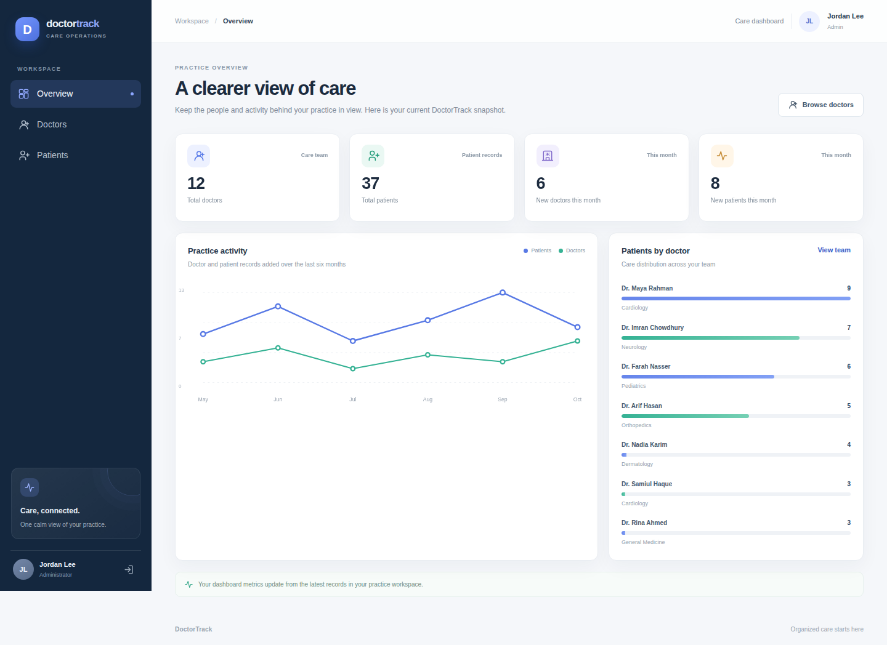
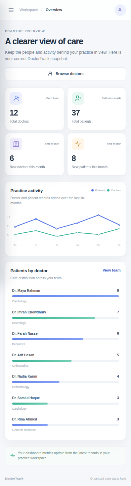

# DoctorTrack

DoctorTrack is a secure admin workspace for organizing a clinic's doctors and patient records, with searchable directories, doctor-to-patient relationships, and a concise view of practice activity. It is designed to keep routine care administration clear and responsive while keeping database access on the backend.

This repository contains the **Next.js frontend only**. The standalone API is maintained in the [doctor-tracker-backend repository](https://github.com/jarir2020/doctor-tracker-backend).

## Project links

- Frontend repository: [doctor-tracker-frontend](https://github.com/jarir2020/doctor-tracker-frontend)
- Backend repository: [doctor-tracker-backend](https://github.com/jarir2020/doctor-tracker-backend)
- Vercel frontend production URL (public): https://doctor-tracker-frontend-eta.vercel.app
- Vercel backend API production URL (public): https://doctor-tracker-backend-woad.vercel.app

## Features

- Admin sign-in with a protected portal.
- Dashboard totals, six-month activity, and patient counts by doctor.
- Doctor directory with doctor creation, search, specialization/date filters, and pagination.
- Doctor profile with linked patient list, patient creation, search, date filters, and pagination.
- Patient directory with search, condition/date filters, pagination, editing, and deletion.
- Responsive layouts for desktop and mobile.

## System architecture and data flow

```text
Browser (same-origin /api) --> Next.js URL rewrite --> Express REST API --Mongoose--> MongoDB Atlas
```

The browser uses the same-origin `/api` path. A Next.js external rewrite forwards those requests to the standalone Express API, so the browser session cookie remains first-party. Set `BACKEND_API_ORIGIN` for the rewrite target and `NEXT_PUBLIC_API_BASE_URL=/api` for the browser client. The Express server authenticates administrators, validates requests, applies filters and pagination, and performs dashboard aggregations. Patient documents reference a doctor. The browser never connects directly to MongoDB.

The frontend and backend are separate applications and separate GitHub repositories. Each is deployed as its own Vercel project; MongoDB Atlas stores the demo data.

## Local setup

Requirements: Node.js 22 or newer, npm, and a running MongoDB instance or MongoDB Atlas URI.

1. Clone this frontend repository and the [backend repository](https://github.com/jarir2020/doctor-tracker-backend) into sibling folders.
2. In `backend/`, copy `.env.example` to `.env`; set `MONGODB_URI`, `SESSION_SECRET`, `ADMIN_EMAIL`, and an `ADMIN_PASSWORD` with at least 12 characters. Follow the backend README to install packages and seed the administrator.
3. In this repository, copy `.env.example` to `.env.local`; the local rewrite target points to the Express API on port 4000:

   ```env
NEXT_PUBLIC_API_BASE_URL=/api
BACKEND_API_ORIGIN=http://localhost:4000
   ```

4. Install and run the frontend:

   ```bash
   npm install
   npm run dev
   ```

5. Open `http://localhost:3000` and sign in with the administrator credentials configured in the backend environment.

The API needs the frontend origin in `FRONTEND_ORIGINS` (default: `http://localhost:3000`). Keep actual `.env` files and credentials out of Git.

## Technical decisions

### 1. Keep the frontend and API in separate repositories

The assignment requires a separate Next.js client and standalone Express server. Keeping separate repositories gives each application its own dependencies, history, deployment, and environment configuration. The REST boundary also keeps MongoDB credentials and database queries on the server.

### 2. Use server-managed admin sessions

The API stores the session on the server in MongoDB and sends the browser an `HttpOnly`, `Secure` session cookie. This avoids keeping an API token in JavaScript-readable browser storage and lets logout invalidate the server-side session. A same-origin `/api` rewrite forwards requests to Express, avoiding third-party-cookie dependence while the backend still checks the allowed frontend origin.

## Screenshots

Screenshots below show the responsive UI with synthetic sample records from a local preview. No real patient information is included.

| Desktop | Mobile |
|---|---|
|  |  |

## Deployment

Deploy both repositories as separate Vercel projects: this repository as the Next.js frontend and the backend repository as the Express API. Vercel loads the backend's `src/app.js` as its Express Function entry point; the local `src/server.js` starts Express with `app.listen` ([Express on Vercel](https://vercel.com/docs/frameworks/backend/express)).

Current production deployments:

- Frontend: https://doctor-tracker-frontend-eta.vercel.app
- Backend API: https://doctor-tracker-backend-woad.vercel.app

Both URLs currently require Vercel authentication. Public evaluator access and GitHub push-to-deploy are pending Vercel account settings: the team has enabled Vercel Authentication, and its GitHub Login Connection must be added before Vercel can link these repositories.

1. Import the backend repository into Vercel first, using its repository root and `main` branch. Set `MONGODB_URI`, `SESSION_SECRET`, `ADMIN_NAME`, `ADMIN_EMAIL`, `ADMIN_PASSWORD`, and `NODE_ENV=production` in the backend project's Production environment. Set `FRONTEND_ORIGINS` after the frontend URL is assigned.
2. Import this repository into Vercel as a Next.js project, using its repository root and `main` as the production branch. Git-connected Vercel projects can deploy from the selected production branch ([Vercel Git deployments](https://vercel.com/docs/git)). Set these Production environment variables:

   ```env
   NEXT_PUBLIC_API_BASE_URL=/api
   BACKEND_API_ORIGIN=https://<your-backend-project>.vercel.app
   ```

3. Copy the assigned frontend production origin (for example, `https://<your-frontend-project>.vercel.app`) into the backend project's `FRONTEND_ORIGINS` setting, without a trailing slash, then redeploy the backend. The Next.js rewrite keeps browser requests on the frontend origin while forwarding them to the API.
4. Seed the demo administrator against the Atlas database from a trusted local checkout by running `npm run seed:admin` in `backend/` with the same values in its ignored `.env` file.
5. Check `https://<your-backend-project>.vercel.app/api/health`, then sign in and verify the doctor and patient workflows through the frontend.

The Atlas IP access list must permit the backend's Vercel outbound connections. Vercel Hobby uses dynamic egress IPs; stable egress IPs require a paid Static IP feature. For a disposable demo, Atlas can temporarily allow connections from any IP, but pair that with a unique database password and remove the broad rule when it is no longer needed ([Vercel outbound IP guidance](https://vercel.com/kb/guide/can-i-get-a-fixed-ip-address), [MongoDB Atlas connectivity troubleshooting](https://www.mongodb.com/docs/manual/troubleshooting/server-selection-timeout/)).

### Submission links

- Frontend GitHub repository: https://github.com/jarir2020/doctor-tracker-frontend
- Backend GitHub repository: https://github.com/jarir2020/doctor-tracker-backend
- Live frontend website: https://doctor-tracker-frontend-eta.vercel.app
- Live backend API: https://doctor-tracker-backend-woad.vercel.app

For evaluation, use synthetic patient records only. Do not add secrets or real patient information to either repository.
